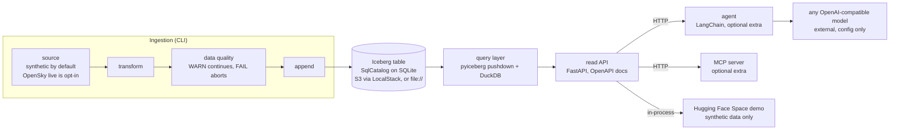

# Real-time agentic data platform

[](https://codecov.io/github/jairajsaraf/realtime-agentic-data-platform)

A data platform built stage by stage and runnable from a fresh clone. It writes flight state vectors
into an [Apache Iceberg](https://iceberg.apache.org/) table on a real catalog, serves them through a
read-only FastAPI/DuckDB API with snapshot time travel, and lets a natural-language agent answer
questions and diagnose data quality by calling that API as its tools.

"Real-time" and "agentic" name the direction, and the backing is deliberately narrow:

- Ingestion is near-real-time micro-batch ingestion, not true streaming. There is no Kafka or Flink.
- The agent is strictly read-only and human-in-the-loop — proposes remediations, never mutates.
  There is no autonomous action, RAG, or fine-tuning.
- Everything tested in CI runs on synthetic data only. The one real-data artifact is a counts-only
  record of a single OpenSky ingest. Real OpenSky data stays
  opt-in, network-gated, never run in CI, never committed.

## Results

Every number below is generated by [`scripts/reproduce.py`](scripts/reproduce.py) into
`results/metrics.json` and rendered here by `make render-results`. Nothing in this README outside
this block is a measurement. Recorded runs (the agent eval, the one OpenSky ingest) are read from
their result files and labelled as recorded, not re-run.

<!-- results:start -->
Not generated yet. Run `make reproduce`, then `make render-results`.
<!-- results:end -->

Read the agent eval rows with their error notes. An attempt that ends in a model-endpoint error
counts as a failure, so a low pass rate with endpoint errors says the run did not measure the agent.
The preregistration, its addenda, and the per-case transcripts are in
[`scripts/agent_eval_scoring.py`](scripts/agent_eval_scoring.py) and `results/agent_eval*.json`.

## Architecture



Dependencies point one way: `agent -> API -> query -> catalog`. All read logic lives in
`rtdp.query`, and `rtdp.api` is a thin transport over it. The agent and the MCP server are plain
HTTP clients of the API. They never import the query layer, the catalog, or DuckDB, and AST tests
enforce that. Ingestion never depends on the API, and neither the API nor the agent mutates the
table. CI and `/health` depend on no model provider, Datadog, Doppler, MinIO, Hugging Face, or the
internet.

## Quick start

Requires Python 3.12 and [uv](https://docs.astral.sh/uv/). Install uv with the official installer:

```bash
# macOS / Linux
curl -LsSf https://astral.sh/uv/install.sh | sh
# Windows (PowerShell)
powershell -ExecutionPolicy ByPass -c "irm https://astral.sh/uv/install.ps1 | iex"
```

Then, from a clone of this repository:

```bash
uv sync --frozen                                  # exact versions from uv.lock
export RTDP_STORAGE_BACKEND=file                  # PowerShell: $env:RTDP_STORAGE_BACKEND="file"
uv run rtdp ingest --source synthetic --rows 50   # each batch is a new Iceberg snapshot
uv run rtdp serve                                 # http://127.0.0.1:8000, docs at /docs
uv run pytest -m "not localstack"
```

The default storage backend is LocalStack S3 (`docker compose up -d`). The `file://` backend above
is a dev/CI convenience only — not the target architecture. Real AWS S3 is a config-only swap
(`RTDP_STORAGE_BACKEND=aws` plus credentials). Use `uv sync --frozen`: an unlocked install can
resolve a newer pyiceberg than the one this repository was built and tested with (see
[Limitations](#limitations)).

Optional extras, none installed by default:

| Extra | Command | What it adds |
| --- | --- | --- |
| `agent` | `uv sync --extra agent` | The LangChain agent behind `rtdp agent`. |
| `mcp` | `uv sync --extra mcp` | `rtdp mcp`, a read-only MCP server over the API (stdio). |
| `otel` | `uv sync --extra otel` | OpenTelemetry export. Without it the telemetry boundary is a no-op. |

Without an extra, `rtdp agent` and `rtdp mcp` exit with an install hint. Step-by-step instructions
for Windows, including the LocalStack path, are in [`RUNBOOK.md`](RUNBOOK.md), along with the
stage-by-stage reference (table design, ingestion and DQ rules, the API in detail, micro-batch
ingestion, the agent, containers and observability).

## What is in it

| Stage | What it adds |
| --- | --- |
| Stage 1, lakehouse | A catalog-backed Iceberg table with schema evolution, partition evolution, snapshot time travel, and ingestion-time data-quality checks (FAIL aborts the write, WARN is reported). |
| Stage 2A, read API | Typed flight reads, bounding-box queries, interval aggregations, and time travel behind an OpenAPI schema. Read-only. |
| Stage 2B, micro-batch | `rtdp stream` polls a source and appends one micro-batch per interval through the same writer. Near-real-time micro-batch ingestion, not true streaming. |
| Stage D, agent | `rtdp agent` answers questions and diagnoses data quality using the read API as its tools. |
| Stage E, ops | One multi-entrypoint container image, compose profiles, an optional OpenTelemetry boundary, and CI/CD. |
| Add-on, MCP | `rtdp mcp` exposes the read endpoints as MCP tools. Another HTTP client of the API, with no write surface. |

### Read API

| Endpoint | Purpose |
| --- | --- |
| `GET /livez` | Liveness: 200 whenever the process is serving. It touches no catalog or table. |
| `GET /health` | Readiness: 200 when the catalog and table are reachable, 503 otherwise. |
| `GET /flights` | Filter by `icao24`, `callsign`, or a time window; `limit` and `offset`. |
| `GET /flights/bbox` | Latitude/longitude bounding box plus an optional time window. |
| `GET /stats/flights-per-interval` | Counts per `hour` or `day`, optionally grouped by `origin_country`. |
| `GET /snapshots` | The Iceberg snapshot history. |
| `GET /meta` | Table identifier, snapshot pointer, schema, and partition spec. |

The read endpoints accept `as_of_snapshot_id` or `as_of_timestamp` for time travel and echo the
snapshot that answered. Filters on `icao24`, `callsign`, and time are pushed into the Iceberg scan,
so partition pruning happens at the table-format level. DuckDB handles the SQL-shaped work. There
is no auth, rate limiting, or caching yet.

### The agent

`rtdp agent` is strictly read-only and human-in-the-loop — proposes remediations, never mutates. It
is built on LangChain's `create_agent` and talks to any OpenAI-compatible
endpoint through `RTDP_AGENT_BASE_URL`, `RTDP_AGENT_MODEL`, and `RTDP_AGENT_API_KEY`.

- Tools come from the live OpenAPI schema through a read-only allowlist of GET endpoints, plus one
  composite `diagnose_data_quality` tool. There is no write tool to call.
- Every answer is followed by a `Sources:` line naming the endpoint and snapshot id of each tool
  call. The line is built from the tool results, never from the model's text.
- A run is bounded by a model-turn budget and a tool-call budget. LangChain's limit middleware
  enforces them, with small hooks that keep the pre-rewrite behaviour. Golden transcripts recorded
  before the rewrite pin that behaviour.
- Data-quality diagnosis re-derives anomalies from the rows the API returns. It is
  a bounded sample (one queried window, capped by the API row limit, over the snapshots queried)
  and the agent says so.
- The CI tests use a scripted chat model. No model is called in CI.

The live eval ([`scripts/eval_agent.py`](scripts/eval_agent.py)) is opt-in and network-gated. It is
never run in CI. It runs a preregistered list of cases on synthetic data and scores the answers
with fixed rules, so the result can be re-scored offline from the stored transcripts. The cases,
pass criteria, bars, and stop rules were frozen before the first live call, and later changes are
recorded as dated addenda. See [ADR 0003](docs/adr/0003-langchain-create-agent.md).

### Demo

[`deploy/hf-space/`](deploy/hf-space/) holds a read-only Hugging Face Space (Gradio SDK) that
ingests seeded synthetic batches at startup and calls the real read API in-process. It exposes
no agent and holds no key. A gated CI job, `deploy-space`, pushes that folder to the Space. The
Space has not been deployed yet, so this README links no live URL. The earlier single-host VM
demo is retired; see [ADR 0004](docs/adr/0004-microbatch-and-synthetic-demo-on-hf-spaces.md).

## CI/CD

`.github/workflows/ci.yml` runs these jobs with top-level `permissions: contents: read`:

| Job | Runs | What it does |
| --- | --- | --- |
| `test` | push, pull request | Lint and the `file://` test suite with coverage. |
| `telemetry-otel` | push, pull request | The telemetry tests with the `otel` extra installed. |
| `mcp-extra` | push, pull request | The MCP tests with the `mcp` extra installed. |
| `agent-extra` | push, pull request | The agent tests (golden transcripts, loop, model boundary, CLI, eval harness) with the `agent` extra installed. |
| `integration-localstack` | push, pull request | The S3 integration tests against LocalStack. |
| `docker-smoke` | push, pull request | Builds the image, checks `/health` on a synthetic `file://` warehouse, and validates the compose files and deploy scripts. |
| `publish-image` | `main` only | Pushes the image to GHCR using the built-in `GITHUB_TOKEN`. |
| `deploy-space` | `main` only | Pushes `deploy/hf-space/` to the Hugging Face Space, behind the protected `production` environment. |

`mcp-extra` and `agent-extra` do not gate publishing or deployment, because the published image
carries neither extra. The VM deploy path (`deploy/host_deploy.sh` and friends) remains as a
portable path, but its host is retired and CI no longer deploys to it.

## Observability

`rtdp.telemetry` is the single seam: structured logging always, and OpenTelemetry tracing only
when `RTDP_OTEL_ENABLED=true` and the `otel` extra is installed. The custom spans are
`rtdp.ingest.batch` and `rtdp.agent.tool_call`. The Datadog dashboard, monitors, and service check
in [`deploy/observability/`](deploy/observability/README.md) were validated live on the retired
host (E6.3); they are not currently deployed. There is no `/metrics` endpoint.

## Limitations

- The `file://` backend is a dev/CI convenience only — not the target architecture. The catalog is
  SQLite, so the topology is single-writer.
- Snapshot maintenance (`rtdp maintain expire-snapshots`) is metadata-only — NOT compaction.
  pyiceberg can expire snapshots but cannot compact or rewrite data files in this build, so small
  files accumulate under micro-batch appends.
- The API has no auth, rate limiting, or caching. The agent consumes it as is.
- `pyproject.toml` allows pyiceberg `>=0.10,<0.13`, but an unlocked install that resolves 0.12
  fails the first partitioned write because `pyiceberg-core` is no longer pulled in. The lockfile
  pins a working version, so use `uv sync --frozen`. A fix to the declared range is tracked
  separately.
- Gemini 3 models, reached through the OpenAI-compatible endpoint, require a thought signature to
  be returned on each replayed tool call. The agent now returns it, based on the field shape
  reported by users. Only the recorded eval runs show whether that worked; read their rows above.
  Model availability also varies by account: one run aborted on a 404 because the model was no
  longer available to new users.
- The agent's data-quality diagnosis is a sample, not an audit, and the eval covers a fixed list of
  cases on a small synthetic dataset.
- The Hugging Face Space is prepared but not deployed, and the VM demo is retired. There is no
  live demo today.

## Decisions

Architecture decision records are in [`docs/adr/`](docs/adr/):

1. [pyiceberg, DuckDB, and a SQLite catalog, with no JVM](docs/adr/0001-pyiceberg-duckdb-sqlite-no-jvm.md)
2. [The agent and the MCP server are HTTP clients of the read API](docs/adr/0002-agent-and-mcp-are-http-clients-of-the-read-api.md)
3. [LangChain `create_agent` with deterministic provenance and budgets](docs/adr/0003-langchain-create-agent.md)
4. [Micro-batch ingestion and a synthetic-only demo on Hugging Face Spaces](docs/adr/0004-microbatch-and-synthetic-demo-on-hf-spaces.md)

## Direction for later stages (not commitments)

- True streaming (Kafka or Flink style), beyond the scheduled micro-batch loop.
- Retrieval (RAG) and vector search, and more agent autonomy than the current read-only,
  human-in-the-loop agent.
- Orchestration and product-facing dashboards, then multi-host deployment beyond a single host.
  Real AWS S3 is already a config-only swap.

## Reproducing the results

```bash
make reproduce         # ruff, tests, synthetic ingest, DQ gate demo, a real `rtdp serve` probe
make render-results    # fill the Results block above from results/metrics.json
```

`make reproduce` makes no live calls: no model and no OpenSky. It re-scores recorded eval runs from
their transcripts and merges the recorded OpenSky run, both labelled as recorded. The generated
`results/metrics.json` carries the commit it measured, and the script refuses to call a run clean
on a dirty working tree.
